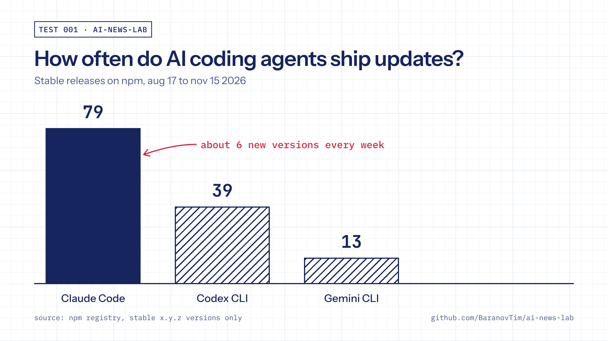

# How often do the big AI coding agents ship updates?

Claude Code put out a lot of updates this fall, so I counted how often it ships next to OpenAI's Codex CLI and Google's Gemini CLI.

## What was measured

Every stable version (plain `x.y.z`, no alpha, nightly, preview or platform builds) published to the public npm registry in the 90 days from 2026-08-17 to 2026-11-15, for:

- `@anthropic-ai/claude-code`
- `@openai/codex`
- `@google/gemini-cli`

The publish dates come straight from the npm registry. The raw data is in `data/`.

## Result

| Tool | Stable releases in 90 days | Per week |
|------|---------------------------:|---------:|
| Claude Code | 79 | 6.1 |
| Codex CLI | 39 | 3.0 |
| Gemini CLI | 13 | 1.0 |



## Limits

- A version count says nothing about how big or how good each update is.
- Teams label releases differently. Codex and Gemini CLI also ship many nightly and alpha builds, which aren't counted here.

## Run it again

```
python main.py            # uses the saved data in data/
python main.py --refresh  # downloads fresh data from npm first
```

The cut-off date is fixed, so a refresh gives the same counts unless a version gets removed from npm.

The chart is drawn from `chart.json` by the repo's shared chart style in [`_style/`](../_style), which needs Node and Playwright.

## Sources

- https://registry.npmjs.org/@anthropic-ai%2fclaude-code
- https://registry.npmjs.org/@openai%2fcodex
- https://registry.npmjs.org/@google%2fgemini-cli
