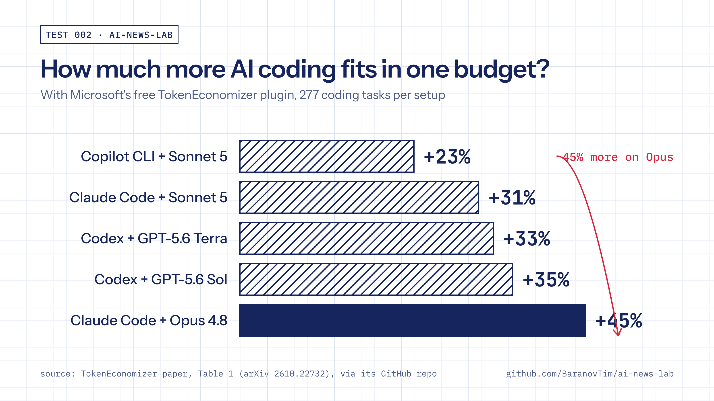

# How much more AI coding fits in one budget?

A post about Microsoft's free TokenEconomizer plugin went around X with the claim "18.4% to 30.9% lower cost" for Claude Code, Codex and Copilot CLI. I checked the published numbers and turned them into the question people care about: how much more work fits before you run out.

## Short answer

The numbers check out. The same budget covers 23% to 45% more work, the most on Claude Code with Opus 4.8.



## What was checked

- The five per-setup numbers the project publishes (the paper's Table 1, arXiv 2610.22732, as plotted in `docs/assets/results_overview.py` in the repo).
- The same numbers written out in the project's README.
- Both copies are saved in `data/`. The script checks they match each other and the headline range.

"More work in the same budget" = 1 / (1 - share saved) - 1. For Opus 4.8: 1 / (1 - 0.309) - 1 = 0.447, so about 45%.

## Result

| Setup | Cheaper | More work, same budget | Tasks solved |
|-------|--------:|-----------------------:|-------------:|
| Claude Code + Sonnet 5 | 23.6% | +31% | 74.7% → 76.0% |
| Claude Code + Opus 4.8 | 30.9% | +45% | 74.0% → 73.0% |
| Codex + GPT-5.6 Terra | 24.7% | +33% | 73.8% → 74.7% |
| Codex + GPT-5.6 Sol | 26.1% | +35% | 80.1% → 81.7% |
| Copilot CLI + Sonnet 5 | 18.4% | +23% | 75.0% → 77.6% |

Tasks solved went up in 4 of 5 setups. Average saving: 24.7%.

## Limits

- These are Microsoft's own benchmark numbers (277 SWE-Bench tasks from 6 repos). I checked them and did the math, I didn't rerun the tasks.
- The plugin learns from earlier sessions in the same project. On brand-new repos the paper reports 6% to 20% savings.
- "More work" assumes your usage limit tracks cost, which is close but not exact for subscription plans.

## Run it again

```
python main.py            # uses the saved files in data/
python main.py --refresh  # downloads them from the TokenEconomizer repo first
```

The chart is drawn from `chart.json` by the repo's shared chart style in [`_style/`](../_style).

## Sources

- https://github.com/microsoft/TokenEconomizer
- https://arxiv.org/abs/2610.22732
