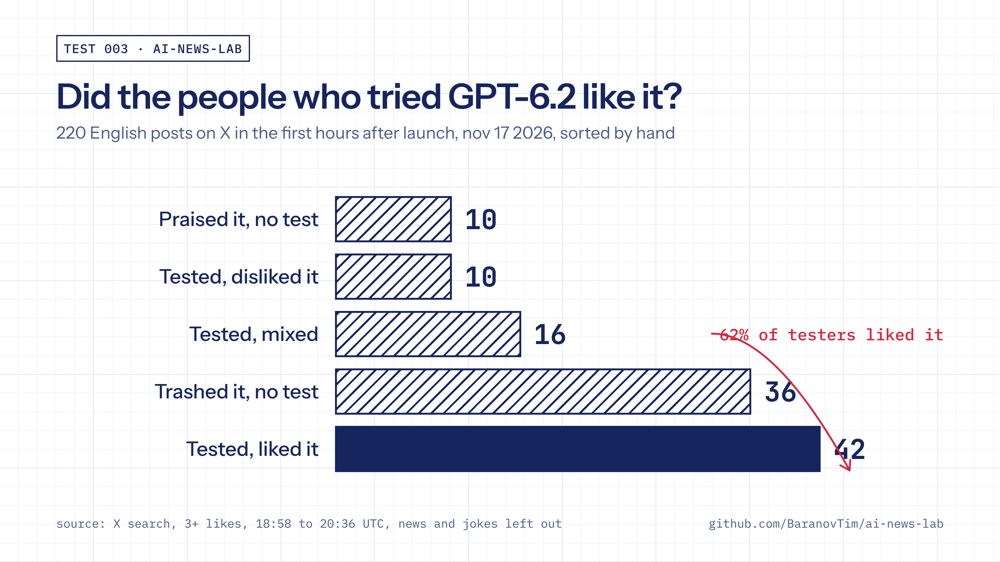

# Did the people who tried GPT-6.2 like it?

OpenAI released GPT-6.2 Astra and Sol on Nov 17, 2026. Within an hour X was calling it the worst model OpenAI ever shipped. This test sorts 220 launch posts to see whether that came from people who actually used it.

## Short answer

Mostly they liked it. Of 68 posts where people showed their own test, 42 liked it (62%) and 10 didn't (15%). The "worst model ever" posts mostly showed no test, and they got about twice the likes.



## How it was done

- Every English post on X naming GPT-6.2 from 18:58 to 20:36 UTC (about 1 to 2.5 hours after launch), no replies or reposts, 3+ likes: 220 posts. Pulled by an AI agent with X search.
- Each post put in one group by hand from its first ~200 characters:
  - **Tested** (liked / mixed / disliked): the author shows or describes their own run (demo, timing, cost, a benchmark they ran, early-access use)
  - **Trashed it / praised it, no test**: a verdict with no own test, including repeating others' reviews or someone else's benchmark
  - **Safety**: system card, alignment, cyber testing
  - **News**: launch info, prices, plain benchmark numbers, "now available in", ads
  - **Other**: jokes, questions, "where is my access", posts about the drama
- `data/posts.tsv` has every post (end of its id, user, likes, time, group, start of the text). `main.py` counts them and draws the chart.

## Result

| Group | Posts | Likes |
|-------|------:|------:|
| Tested, liked it | 42 | 1,211 |
| Tested, mixed | 16 | 389 |
| Tested, disliked it | 10 | 240 |
| Trashed it, no test | 36 | 2,612 |
| Praised it, no test | 10 | 141 |
| Safety | 9 | 777 |
| News | 55 | 1,229 |
| Other | 42 | 765 |

36 of the 46 negative verdicts (78%) came with no test. Most of the happy testers were showing 3D scenes, games and art.

## Limits

One AI agent did the sorting, so some calls are judgment. A simple keyword rule agreed with the hand sort on 82% of posts as a rough check, but it misses demo posts that don't say "I". People who post demos lean positive, and this only covers the first hours. It shows what early testers posted, not how good the model is. A hands-on test in ChatGPT wasn't possible: GPT-6.2 is paid plans only.

## Run it

```
python main.py
```
